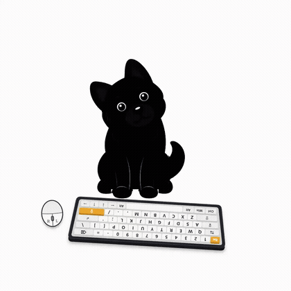

# KuroDog · 小黑狗

一只会跟着你敲键盘、追鼠标，摸摸头就变飞机耳的桌面小狗。

[下载免安装版](https://github.com/yanm299-bit/kurodog/releases/download/v1.1.3/KuroDog-1.1.3-windows-x64.exe) · [下载安装版](https://github.com/yanm299-bit/kurodog/releases/download/v1.1.3/KuroDog-1.1.3-x64-setup.exe) · [查看全部版本](https://github.com/yanm299-bit/kurodog/releases)

## Windows 10 / 11（x64）

- **免安装版**下载后双击运行。**安装版**运行后按向导操作。
- **放大或缩小**右键点击小黑狗，或打开 Windows 系统托盘里的小黑狗菜单，选择「缩放大小」。
- **打开鼠标穿透**在菜单里勾选「锁定鼠标穿透」。按住 **Alt** 可以临时操作，也可以在托盘菜单里取消勾选。
- **摸头**把光标放在狗头上来回移动，耳朵会向两侧放平。按键气泡可以在菜单里关闭。

## 让 AI 帮你安装

将 [kurodog Skill](skills/kurodog/SKILL.md) 安装到支持 Agent Skills 的客户端，然后对它说「帮我安装 KuroDog」或「小黑狗开启鼠标穿透后，怎么恢复？」。

在 Codex 中，可以对内置的 Skill 安装器说「从 GitHub 仓库 yanm299-bit/kurodog 的 skills/kurodog 目录安装这个 Skill」。按客户端提示刷新 Skill 列表后即可使用。

## 从源码构建

需要 Node.js 22、Rust MSVC 工具链、Visual Studio C++ Build Tools 和 WebView2。

~~~powershell
npm ci
npm run tauri:dev
~~~

运行 npm 脚本生成 Windows 安装包。

~~~powershell
npm run tauri:build -- --bundles nsis
~~~

运行 npm 脚本构建白底浏览器预览，输出目录为 dist-web。

~~~powershell
npm run build:web
~~~

## 来源与许可

本项目基于 [qianyiai 的 KuroCat v4.7.0](https://github.com/qianyiai/kurocat/tree/v4.7.0) 改编，沿用了上游的全局键鼠监听、透明窗口交互、键盘和鼠标绘制。小黑狗版换用了新的角色形象、前爪动作和摸头时的飞机耳动画。感谢 KuroCat Contributors，原始版权声明见 [MIT 许可证](LICENSE)。
